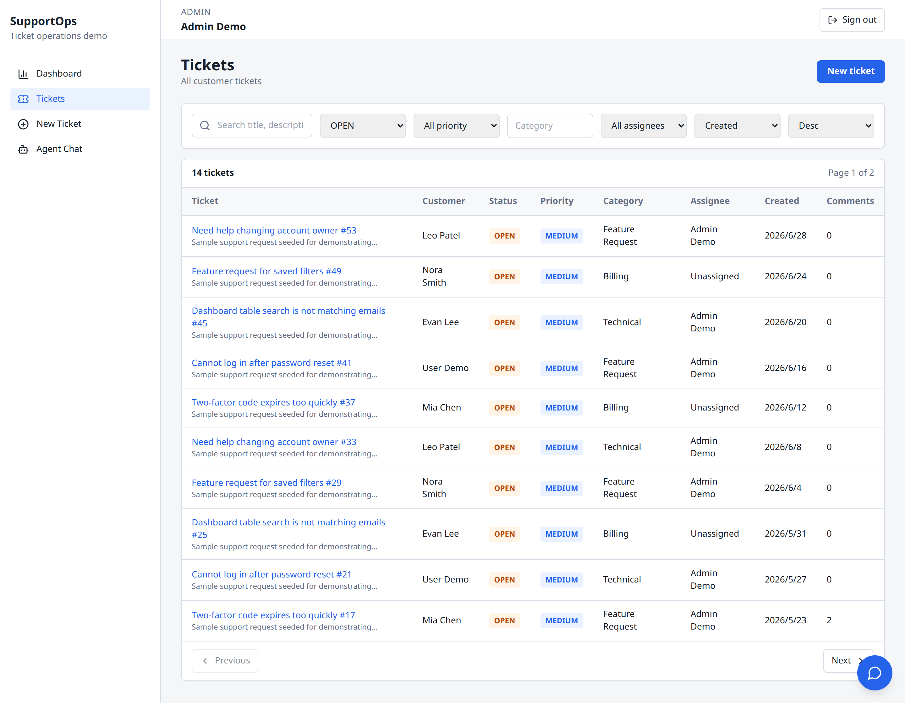
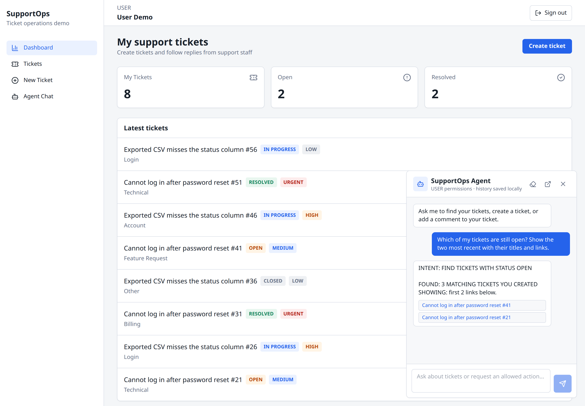

# Support Ticket Demo

A full-stack SaaS support ticket dashboard with role-based access, a filterable ticket table, comments, status history, admin metrics, and an authenticated chatbot that can query and update tickets within the signed-in user's permissions.

It is a portfolio project that shows the everyday work business admin dashboards need: JWT auth, role-based access control, search / filter / sort / pagination backed by a REST API, CRUD forms, status workflows with an audit trail, PostgreSQL modeling with Prisma, and API handoff docs.

**Live demo:** https://support-ticket.dreaifehebi.com

| Role  | Email               | Password      |
| ----- | ------------------- | ------------- |
| Admin | `admin@example.com` | `password123` |
| User  | `user@example.com`  | `password123` |

The login page has one-click buttons for both demo accounts.

## Screenshots

Admin dashboard with live metrics:


Ticket list with search, filters, sorting, and pagination:



Ticket detail with comments, status history, and admin controls:


Chatbot panel answering a question scoped to the signed-in user:



## Features

### Admin

- Operations dashboard: total, open, resolved, and urgent ticket counts, average resolution time, tickets by status, and tickets created over the last 7 days.
- Ticket table across all users with keyword search, filters for status, priority, category, and assignee, sorting, and pagination.
- Update status, change priority, assign an owner, and reply in comments on any ticket.

### User

- Register and log in.
- Create tickets and see only their own tickets.
- Edit and comment on their own tickets.

### Ticket workflow

- Every status change writes a `ticket_status_history` record.
- Setting a ticket to `RESOLVED` sets `resolvedAt` if it is empty; reopening to `OPEN` or `IN_PROGRESS` clears it; `CLOSED` keeps it.
- The API rejects invalid status and priority values and blocks users from other users' tickets and from admin-only endpoints.

### Chatbot

- Available as a bottom-right floating panel after login and as a full `/chat` page; both share the same conversation history.
- Answers ticket questions and runs allowed actions: list and read tickets, create tickets, add comments, and (for admins) change status, change priority, and assign tickets.
- The model only chooses an action from a fixed list. The API checks the JWT user, role, and ticket ownership before running it, and the model never gets direct database access.
- There are no delete actions. Replies link to pages such as `/tickets/:id` instead of claiming to open them.

Action list and permission model: [docs/agent.md](docs/agent.md).

## Tech Stack

- **Frontend:** Next.js, React, TypeScript, Tailwind CSS, Recharts
- **Backend:** Node.js, Express, TypeScript, Zod
- **Database:** PostgreSQL with Prisma ORM
- **Auth:** JWT, bcrypt
- **Chatbot:** any OpenAI-compatible Chat Completions API
- **DevOps:** Docker Compose; the hosted demo runs behind Cloudflare Tunnel

npm workspaces monorepo:

```txt
apps/web          Next.js frontend
apps/api          Express API
packages/shared   Shared enums and types
prisma/           Schema and seed data
docs/             API, database, chatbot, and deployment docs
```

## Quick Start

### Local

Requires Node.js (the Docker setup uses Node 22) and a reachable PostgreSQL database.

```bash
npm install
cp .env.example .env
docker compose up -d postgres   # optional: run only the database in Docker
npm run db:generate
npm run db:push
npm run seed
npm run dev
```

- Web: http://localhost:3000
- API: http://localhost:4000
- Health check: http://localhost:4000/health

The seed creates the demo accounts above, extra admins and users, and 56 sample tickets with comments and status history, so filters, pagination, and charts have data to show.

### Docker

```bash
docker compose up
```

This starts PostgreSQL, runs Prisma generate, `db push`, and the seed, then serves the API on port `4000` and the web app on port `3000`.

To use the chatbot, set `OPENAI_API_KEY` in `.env`. Without it, `POST /api/chat` returns `503` and everything else works normally.

LAN access and other local notes: [docs/local-development.md](docs/local-development.md). The hosted demo is deployed with `docker-compose.cf.yml` behind Cloudflare Tunnel: [docs/deploy-cloudflare-tunnel.md](docs/deploy-cloudflare-tunnel.md).

## Environment Variables

Copy `.env.example` to `.env`. Main values:

| Variable              | Purpose                                                      |
| --------------------- | ------------------------------------------------------------ |
| `DATABASE_URL`        | PostgreSQL connection string                                 |
| `JWT_SECRET`          | Secret used to sign JWTs                                     |
| `PORT`                | API port (default `4000`)                                    |
| `CORS_ORIGIN`         | Comma-separated allowed web origins                          |
| `NEXT_PUBLIC_API_URL` | API base URL used by the frontend                            |
| `OPENAI_BASE_URL`     | OpenAI-compatible API base URL                               |
| `OPENAI_API_KEY`      | Chatbot API key (optional; the chatbot is off when unset)    |
| `DEFAULT_MODEL`       | Chat model name                                              |

`POSTGRES_DB`, `POSTGRES_USER`, `POSTGRES_PASSWORD`, and `TUNNEL_NETWORK` are only used by the Cloudflare Tunnel deployment.

## API Overview

All routes are under `/api`. Everything except register and login requires a `Bearer` JWT.

| Method  | Path                    | Description                                              |
| ------- | ----------------------- | -------------------------------------------------------- |
| `POST`  | `/auth/register`        | Create a user account                                    |
| `POST`  | `/auth/login`           | Log in and receive a JWT                                 |
| `GET`   | `/me`                   | Current user                                             |
| `GET`   | `/tickets`              | Paginated list with search, filters, and sorting         |
| `POST`  | `/tickets`              | Create a ticket                                          |
| `GET`   | `/tickets/:id`          | Ticket detail with comments and status history           |
| `PATCH` | `/tickets/:id`          | Edit ticket fields; admins can also set priority/assignee |
| `PATCH` | `/tickets/:id/status`   | Change status and write status history (admin)           |
| `POST`  | `/tickets/:id/comments` | Add a comment                                            |
| `GET`   | `/admin/stats`          | Dashboard metrics (admin)                                |
| `GET`   | `/admin/users`          | Users with ticket counts, for assignment (admin)         |
| `POST`  | `/chat`                 | Send a chatbot message                                   |

Example list query:

```txt
GET /api/tickets?page=1&limit=10&search=login&status=OPEN&priority=HIGH&sort=createdAt&order=desc
```

Request and response details: [docs/api.md](docs/api.md).

## Data Model

Four tables: `users`, `tickets`, `comments`, and `ticket_status_history`. Users have a `USER` or `ADMIN` role. Tickets have a status (`OPEN`, `IN_PROGRESS`, `RESOLVED`, `CLOSED`), a priority (`LOW`, `MEDIUM`, `HIGH`, `URGENT`), a category, a creator, and an optional assignee.

Field lists and access rules: [docs/database.md](docs/database.md). Schema: [prisma/schema.prisma](prisma/schema.prisma).

## Design Tradeoffs

- **Token storage:** the JWT is kept in `localStorage` so the demo is easy to inspect. A production app would use httpOnly cookies.
- **Chat history:** stored in the browser per user. The chat API is stateless and receives recent messages with each request; there is no server-side conversation table.
- **Schema changes:** setup uses `prisma db push` for a one-command start instead of committed migrations.
- **Scope:** file attachments, SLA timers, CSV export, and email notifications are out of scope.

## License

[MIT](LICENSE)
